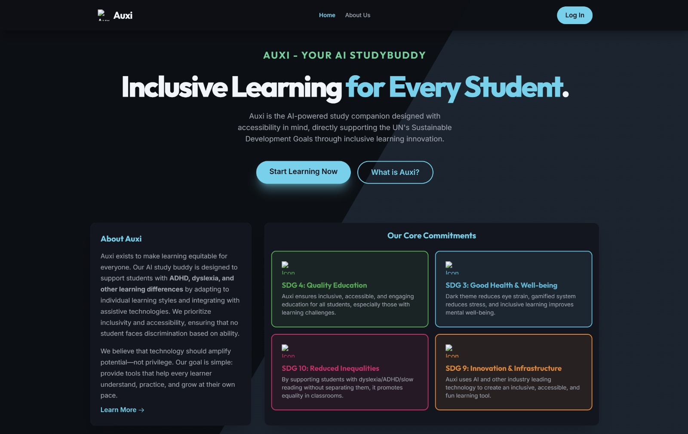

<h1 align="center">Auxi</h1>

<p align="center">An AI study buddy for kids with learning disabilities.</p>

<p align="center">
  <a href="https://auxiorg.netlify.app/">Live site</a>
</p>

<p align="center">
  
</p>

---

## About

Auxi is a study tool for children who find standard learning material hard to follow. It explains topics in short, simple steps and lets the child go at their own pace.

## Features

- Step-by-step explanations in plain language
- Clean, uncluttered layout
- Works in the browser, nothing to install

## Stack

HTML, Tailwind CSS, JavaScript. Hosted on Netlify.

## Run locally

```bash
git clone https://github.com/YOUR_USERNAME/auxi.git
cd auxi
```

Open `index.html` in your browser.

---

<p align="center"><sub>Built by <a href="https://divskoo.netlify.app/">Divya / Koo</a></sub></p>
